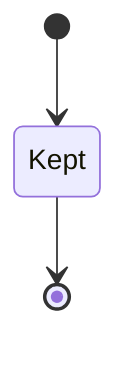
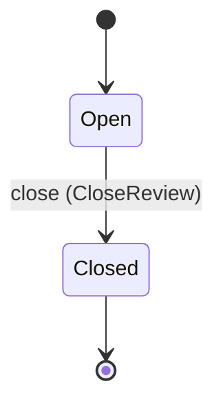
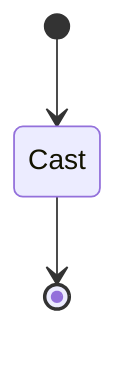

<!--
generated from cortex v1
model digest 1a8b2b2fdcd1c2fa99e3ef30ae0308905274ee31ed5cdcbd8ffa361e90854168
contract digest slice-sha256/2:07018ecff522e05886727a430a0f04565a69a35db7bbbfc594c0d88a6f351a7f
do not edit: regenerate with `ess generate`
-->

# Answers

The answer service of an instance: `cortex ask serve` answers a question over the instance's store as a stream of events. It reads the store only through the EKR MCP reader (`ekr mcp`) and writes nothing to it; its model is the instance's model gateway, spoken to as an OpenAI-compatible endpoint. Every answer is streamed and kept as an answer record, with the votes of its readers; an answer voted down, failed or slow is queued for review. The records are cortex's own, in `ask.sqlite` in the instance directory, never in the store, and are purged after the spec's `retention_days`.

`cortex.ask` is one of cortex's bounded contexts. [Back to the index](../index.md).

## Types

### `AnswerId`

`cortex.ask.AnswerId` wraps `String` and is not interchangeable with one: the whole value of naming it separately is the crossings the model then refuses.

### `AnswerOutcome`

`cortex.ask.AnswerOutcome` is one of `answered`, `failed` and `limited`.

### `AskDelta`

`cortex.ask.AskDelta` is a record of one field:

- `text` — `String`

### `AskDiscard`

`cortex.ask.AskDiscard` is a record of one field:

- `step` — `Integer`

### `AskDone`

`cortex.ask.AskDone` is a record of 10 fields:

- `answer_id` — `String`
- `answer` — `String`
- `nodes` — `List<String>`
- `evidence` — `List<String>`
- `input_tokens` — `Integer`
- `output_tokens` — `Integer`
- `cached_tokens` — `Integer`
- `context_tokens` — `Integer`
- `steps` — `Integer`
- `unrestored` — `Integer`

### `AskError`

`cortex.ask.AskError` is a record of three fields:

- `reason` — `String`
- `message` — `String`
- `retry_after` — `Optional<Integer>`, which may be absent

### `AskEvent`

`cortex.ask.AskEvent` is one of six shapes, told apart by a `event` field — tagged, so a decoder never has to guess which branch it is reading:

- `delta` — `cortex.ask.AskDelta`
- `discard` — `cortex.ask.AskDiscard`
- `done` — `cortex.ask.AskDone`
- `error` — `cortex.ask.AskError`
- `status` — `cortex.ask.AskStatus`
- `tool` — `cortex.ask.AskTool`

### `AskLimits`

`cortex.ask.AskLimits` is a record of four fields:

- `max_steps` — `Integer`
- `max_result_bytes` — `Integer`
- `max_seconds` — `Integer`
- `per_identity_per_minute` — `Integer`

### `AskSpec`

`cortex.ask.AskSpec` is a record of seven fields:

- `listen` — `String`
- `identity_header` — `String`
- `limits` — `cortex.ask.AskLimits`
- `link_templates` — `Optional<cortex.ask.LinkTemplates>`, which may be absent
- `guidance` — `Optional<String>`, which may be absent
- `retention_days` — `Optional<Integer>`, which may be absent
- `slow_after_ms` — `Optional<Integer>`, which may be absent

### `AskStatus`

`cortex.ask.AskStatus` is a record of three fields:

- `format` — `String`
- `step` — `Integer`
- `message` — `String`

### `AskTool`

`cortex.ask.AskTool` is a record of seven fields:

- `step` — `Integer`
- `name` — `String`
- `arguments` — `String`
- `result_bytes` — `Integer`
- `truncated` — `Boolean`
- `failed` — `Boolean`
- `withheld` — `Boolean`

### `LinkTemplates`

`cortex.ask.LinkTemplates` is a record of two fields:

- `node` — `Optional<String>`, which may be absent
- `evidence` — `Optional<String>`, which may be absent

### `ReviewCause`

`cortex.ask.ReviewCause` is one of `voted-down`, `failed` and `slow`.

### `ReviewId`

`cortex.ask.ReviewId` wraps `String` and is not interchangeable with one: the whole value of naming it separately is the crossings the model then refuses.

### `VoteId`

`cortex.ask.VoteId` wraps `String` and is not interchangeable with one: the whole value of naming it separately is the crossings the model then refuses.

### `VoteValue`

`cortex.ask.VoteValue` is one of `up` and `down`.

One of the types above is reached by nothing else in this system: `cortex.ask.AskEvent`. No entity, view, command, event, error or crossing names it, so it is either vocabulary something outside this specification uses or a leftover — and only a person can tell which.

## Entities

An entity is what this context is about: something with an identity that outlives any one request, a shape, and a lifecycle. The lifecycle is exhaustive — a move that is not drawn below is a move this specification does not permit, and that is the only way it says so. Every move is labelled with the command that takes it, because a move nothing can trigger is refused rather than drawn.

### `AnswerRecord`

`cortex.ask.AnswerRecord`.

An instance is identified by `answer_id`, a `cortex.ask.AnswerId`. The name is part of the model and not a convention: a view projects the identity under that name, so a projection inventing its own would disagree with the view.

It holds:

- `instance_name` — `cortex.instance.InstanceName`
- `identity` — `String`
- `question` — `String`
- `answer` — `Optional<String>`, which may be absent
- `reason` — `Optional<String>`, which may be absent
- `outcome` — `cortex.ask.AnswerOutcome`
- `tool_calls` — `List<cortex.ask.AskTool>`
- `latency_ms` — `Integer`
- `input_tokens` — `Integer`
- `output_tokens` — `Integer`
- `cached_tokens` — `Integer`
- `context_tokens` — `Integer`
- `steps` — `Integer`
- `at` — `Timestamp`

It owns any number of [`Vote`](#vote), as `votes`, carried by `Vote.answer_id`. It owns any number of [`ReviewItem`](#reviewitem), as `reviews`, carried by `ReviewItem.answer_id`. Its `instance_name` is what [`cortex.instance.Instance`](cortex-instance.md#instance) owns it by, as `answers`.

Every instance satisfies `latency_ms >= 0`, `input_tokens >= 0`, `output_tokens >= 0`, `cached_tokens >= 0`, `context_tokens >= 0` and `steps >= 0` — a predicate over this entity's own fields, checked against them rather than stored as a sentence, so an invariant reading something the entity does not have is refused instead of documented.

Its state is a `cortex.ask.AnswerRecord.State`, one of `Kept`. That enum is synthesised from the lifecycle rather than declared beside it, so the states a view's filter compares and the states drawn below cannot disagree.

An instance is created in `Kept`. `Kept` is terminal, so an instance may rest there forever. That is declared rather than inferred from having no way out: an entity that cannot leave a state is either finished or stuck, and only its author knows which.

It declares no moves, so nothing changes its state once it exists.

It has one state, so there is no move to permit or to forbid.

No view projects it, so nothing outside this context is promised a way to observe one.

### `ReviewItem`

`cortex.ask.ReviewItem`.

An instance is identified by `review_id`, a `cortex.ask.ReviewId`. The name is part of the model and not a convention: a view projects the identity under that name, so a projection inventing its own would disagree with the view.

It holds:

- `answer_id` — `cortex.ask.AnswerId`
- `cause` — `cortex.ask.ReviewCause`
- `opened_at` — `Timestamp`
- `close_reason` — `Optional<String>`, which may be absent
- `closed_at` — `Optional<Timestamp>`, which may be absent

Its `answer_id` is what [`AnswerRecord`](#answerrecord) owns it by, as `reviews`.

No invariant is declared, so nothing here constrains an instance at rest.

Its state is a `cortex.ask.ReviewItem.State`, one of `Closed` and `Open`. That enum is synthesised from the lifecycle rather than declared beside it, so the states a view's filter compares and the states drawn below cannot disagree.

An instance is created in `Open`. `Closed` is terminal, so an instance may rest there forever. That is declared rather than inferred from having no way out: an entity that cannot leave a state is either finished or stuck, and only its author knows which.

Each move is taken by a declared command outcome, and a move nothing takes is refused as `missing_causation` rather than left as a state change nobody can trigger:

- `close` — taken by `cortex.ask.CloseReview` on its `closed` outcome

An instance is brought into existence by `cortex.ask.OpenReview` on its `opened` outcome.

Illegal transitions are illegal by absence: no rule forbids them, there is simply no arrow, because a rule would be a second place for the same truth to live. A diagram cannot show an absence, so the pairs it does not connect are listed here, derived from the same transitions — anything named below is a move this specification does not permit.

- `Closed` may not become `Open`

One view projects it: [`OpenReviews`](#openreviews).

### `Vote`

`cortex.ask.Vote`.

An instance is identified by `vote_id`, a `cortex.ask.VoteId`. The name is part of the model and not a convention: a view projects the identity under that name, so a projection inventing its own would disagree with the view.

It holds:

- `answer_id` — `cortex.ask.AnswerId`
- `identity` — `String`
- `value` — `cortex.ask.VoteValue`
- `comment` — `Optional<String>`, which may be absent
- `at` — `Timestamp`

Its `answer_id` is what [`AnswerRecord`](#answerrecord) owns it by, as `votes`.

No invariant is declared, so nothing here constrains an instance at rest.

Its state is a `cortex.ask.Vote.State`, one of `Cast`. That enum is synthesised from the lifecycle rather than declared beside it, so the states a view's filter compares and the states drawn below cannot disagree.

An instance is created in `Cast`. `Cast` is terminal, so an instance may rest there forever. That is declared rather than inferred from having no way out: an entity that cannot leave a state is either finished or stuck, and only its author knows which.

It declares no moves, so nothing changes its state once it exists.

It has one state, so there is no move to permit or to forbid.

No view projects it, so nothing outside this context is promised a way to observe one.

## Views

A view is what the outside world is promised it can observe. Each one says which instances it contains and how soon it reflects a command that has already returned, because "you can read this" without "how soon" is the promise every flaky suite is built on.

### `OpenReviews`

`cortex.ask.OpenReviews`, shown to a person as "Open reviews" and called `review` on the wire.

It reads [`ReviewItem`](#reviewitem).

It contains the instances where `state == Open` holds, and only those — so an instance a caller cannot find in here has been filtered out rather than lost.

It exposes:

- `review_id` — `cortex.ask.ReviewId`
- `answer_id` — `cortex.ask.AnswerId`
- `cause` — `cortex.ask.ReviewCause`
- `opened_at` — `Timestamp`

Its rows are ordered by `opened_at` ascending.

**Read-your-writes**: it is current the moment the command that changed it returns. A caller that has just created an invoice and cannot see it in here has been told a lie about what it did.

A generated scenario asserts it once, immediately after the command: a view promising this and not keeping the promise has to fail the suite rather than be retried until it passes.

## Commands

### `Ask`

`cortex.ask.Ask`, shown to a person as "Ask a question" and called `ask` on the wire.

It takes:

- `question` — `String`
- `identity` — `String`

It has six outcomes.

**`unidentified`** — It answers 401; no model was asked. Decided outside the input: The request carries no identity in the header the spec names. No predicate over the input reaches this branch, and saying `when: false` instead would have claimed it is unreachable, which is a different and false statement. No entity in this specification changes. It reports `cortex.ask.Unidentified`, carrying `header`. It emits nothing. A test reaches it by injecting the declared fault, because no input can.

**`rate-limited`** — It answers 429 with an `error` event carrying `retry_after`; no model was asked. Decided outside the input: The identity asked its per-minute limit of questions in the last minute. No predicate over the input reaches this branch, and saying `when: false` instead would have claimed it is unreachable, which is a different and false statement. No entity in this specification changes. It reports `cortex.ask.RateLimited`, carrying `identity` and `retry_after`. It emits nothing. A test reaches it by injecting the declared fault, because no input can.

**`limit-reached`** — The stream ends with an `error` event naming the limit, and no `done`. Decided outside the input: The model still asks for a tool at the step limit, or the time limit passes. No predicate over the input reaches this branch, and saying `when: false` instead would have claimed it is unreachable, which is a different and false statement. No entity in this specification changes. It reports `cortex.ask.LimitReached`, carrying `limit`. It emits nothing. A test reaches it by injecting the declared fault, because no input can.

**`model-failed`** — The stream ends with an `error` event, and no `done`. Decided outside the input: The model gateway cannot be reached or answers an error. No predicate over the input reaches this branch, and saying `when: false` instead would have claimed it is unreachable, which is a different and false statement. No entity in this specification changes. It reports `cortex.ask.ModelFailed`, carrying `reason`. It emits nothing. A test reaches it by injecting the declared fault, because no input can.

**`reader-failed`** — The stream ends with an `error` event, and no `done`. Decided outside the input: The EKR MCP reader cannot be started or stops answering. No predicate over the input reaches this branch, and saying `when: false` instead would have claimed it is unreachable, which is a different and false statement. No entity in this specification changes. It reports `cortex.ask.ReaderFailed`, carrying `reason`. It emits nothing. A test reaches it by injecting the declared fault, because no input can.

**`answered`** — The stream ends with a `done` event carrying the answer and what it cites. The default branch, taken when no other outcome's condition matched. No entity in this specification changes. It emits `cortex.ask.Answered`. A test reaches it by constructing an input that satisfies no other outcome's condition.

### `CastVote`

`cortex.ask.CastVote`, shown to a person as "Vote on an answer" and called `vote` on the wire.

It takes:

- `vote_id` — `cortex.ask.VoteId`
- `answer_id` — `cortex.ask.AnswerId`
- `identity` — `String`
- `value` — `cortex.ask.VoteValue`
- `comment` — `Optional<String>`, which may be absent

It has four outcomes.

**`unidentified`** — It answers 401; nothing was cast. Decided outside the input: The request carries no identity in the header the spec names. No predicate over the input reaches this branch, and saying `when: false` instead would have claimed it is unreachable, which is a different and false statement. No entity in this specification changes. It reports `cortex.ask.Unidentified`, carrying `header`. It emits nothing. A test reaches it by injecting the declared fault, because no input can.

**`no-such-answer`** — It answers 404; nothing was cast. Decided outside the input: No answer record carries `answer_id`. No predicate over the input reaches this branch, and saying `when: false` instead would have claimed it is unreachable, which is a different and false statement. No entity in this specification changes. It reports `cortex.ask.AnswerNotFound`, carrying `answer_id`. It emits nothing. A test reaches it by injecting the declared fault, because no input can.

**`changed`** — The identity's vote on the answer is replaced; it still has one. The default branch, taken when no other outcome's condition matched. It changes a `cortex.ask.Vote` without moving it along its lifecycle. The instance is the one named by the input field `vote_id`. It emits `cortex.ask.Voted`. It sets `value` from `input.value`, `comment` from `input.comment` and `at` from `implementation-generated`. A test reaches it by constructing an input that satisfies no other outcome's condition.

**`cast`** — The identity's first vote on the answer is kept. Taken when no record carries the identity the command names, and no input-guarded refusal applies; it creates that record. It creates a `cortex.ask.Vote`, which starts in `Cast`. The new instance's identity is published as `vote_id` on `cortex.ask.Voted`. It emits `cortex.ask.Voted`. It sets `answer_id` from `input.answer_id`, `identity` from `input.identity`, `value` from `input.value`, `comment` from `input.comment` and `at` from `implementation-generated`. A test reaches it by sending an identity no record carries, arranging nothing.

### `CloseReview`

`cortex.ask.CloseReview`, shown to a person as "Close a review item" and called `close-review` on the wire.

It takes:

- `review_id` — `cortex.ask.ReviewId`
- `reason` — `String`

It has three outcomes.

**`closed`** — The item leaves the review queue with its reason. The default branch, taken when no other outcome's condition matched. It moves a `cortex.ask.ReviewItem` from `Open` to `Closed`, along the declared move `close`. The instance is the one named by the input field `review_id`. It emits `cortex.ask.ReviewClosed`. It sets `close_reason` from `input.reason` and `closed_at` from `implementation-generated`. A test reaches it by constructing an input that satisfies no other outcome's condition.

**`wrong-state`** — It answers 409; the item keeps the reason it was closed with. Taken when the subject is resting in a state none of this command's moves start from — a `cortex.ask.ReviewItem` in `Closed`, which is what is left of the lifecycle once this command's own moves are taken away. The document lists none of it. No entity in this specification changes. It reports `cortex.ask.ReviewNotOpen`, carrying `review_id`. It emits nothing. A test reaches it by driving an instance into one of those states and then issuing the command, because no input selects this branch.

**`no-such-review`** — It answers 404; nothing changed. Taken when the identity the command names is one no record carries, before any other answer for it. No entity in this specification changes. It reports `cortex.ask.ReviewNotFound`, carrying `review_id`. It emits nothing. A test reaches it by sending an identity no record carries, arranging nothing.

### `OpenReview`

`cortex.ask.OpenReview`, shown to a person as "Open a review item" and called `open-review` on the wire.

It takes:

- `review_id` — `cortex.ask.ReviewId`
- `answer_id` — `cortex.ask.AnswerId`
- `cause` — `cortex.ask.ReviewCause`

It has two outcomes.

**`opened`** — The answer is in the review queue for this cause. The default branch, taken when no other outcome's condition matched. It creates a `cortex.ask.ReviewItem`, which starts in `Open`. The new instance's identity is published as `review_id` on `cortex.ask.ReviewOpened`. It emits `cortex.ask.ReviewOpened`. It sets `answer_id` from `input.answer_id`, `cause` from `input.cause` and `opened_at` from `implementation-generated`. A test reaches it by constructing an input that satisfies no other outcome's condition.

**`exists`** — The answer already has an item for this cause; nothing changed. Taken when a record already carries the identity the command's creating branch would create, and no input-guarded refusal applies. No entity in this specification changes. It reports `cortex.ask.ReviewExists`, carrying `review_id`. It emits nothing. A test reaches it by sending the command twice with one identity: the first call creates the record, the second is answered by this branch.

### `PurgeExpired`

`cortex.ask.PurgeExpired`, shown to a person as "Purge expired answers" and called `purge` on the wire.

It takes:

- `before` — `Timestamp`

It has one outcome.

**`purged`** — Nothing older than `before` is left. The default branch, taken when no other outcome's condition matched. No entity in this specification changes. It emits `cortex.ask.Purged`. A test reaches it by constructing an input that satisfies no other outcome's condition.

### `RecordAnswer`

`cortex.ask.RecordAnswer`, shown to a person as "Record an answer" and called `record` on the wire.

It takes:

- `answer_id` — `cortex.ask.AnswerId`
- `instance_name` — `cortex.instance.InstanceName`
- `identity` — `String`
- `question` — `String`
- `answer` — `Optional<String>`, which may be absent
- `reason` — `Optional<String>`, which may be absent
- `outcome` — `cortex.ask.AnswerOutcome`
- `tool_calls` — `List<cortex.ask.AskTool>`
- `latency_ms` — `Integer`
- `input_tokens` — `Integer`
- `output_tokens` — `Integer`
- `cached_tokens` — `Integer`
- `context_tokens` — `Integer`
- `steps` — `Integer`
- `at` — `Timestamp`

It has one outcome.

**`recorded`** — The answer is kept until it is past `retention_days`. The default branch, taken when no other outcome's condition matched. It creates a `cortex.ask.AnswerRecord`, which starts in `Kept`. The new instance's identity is published as `answer_id` on `cortex.ask.AnswerRecorded`. It emits `cortex.ask.AnswerRecorded`. It sets `instance_name` from `input.instance_name`, `identity` from `input.identity`, `question` from `input.question`, `answer` from `input.answer`, `reason` from `input.reason`, `outcome` from `input.outcome`, `tool_calls` from `input.tool_calls`, `latency_ms` from `input.latency_ms`, `input_tokens` from `input.input_tokens`, `output_tokens` from `input.output_tokens`, `cached_tokens` from `input.cached_tokens`, `context_tokens` from `input.context_tokens`, `steps` from `input.steps` and `at` from `input.at`. A test reaches it by constructing an input that satisfies no other outcome's condition.

## Events

### `AnswerRecorded`

`cortex.ask.AnswerRecorded`.

It carries:

- `answer_id` — `cortex.ask.AnswerId`
- `outcome` — `cortex.ask.AnswerOutcome`

Emitted by `cortex.ask.RecordAnswer` on its `recorded` outcome.

Nothing in this system reacts to it.

### `Answered`

`cortex.ask.Answered`.

It carries:

- `identity` — `String`
- `done` — `cortex.ask.AskDone`

Emitted by `cortex.ask.Ask` on its `answered` outcome.

Nothing in this system reacts to it.

### `Purged`

`cortex.ask.Purged`.

It carries:

- `before` — `Timestamp`
- `records` — `Integer`
- `votes` — `Integer`
- `reviews` — `Integer`

Emitted by `cortex.ask.PurgeExpired` on its `purged` outcome.

Nothing in this system reacts to it.

### `ReviewClosed`

`cortex.ask.ReviewClosed`.

It carries:

- `review_id` — `cortex.ask.ReviewId`
- `reason` — `String`

Emitted by `cortex.ask.CloseReview` on its `closed` outcome.

Nothing in this system reacts to it.

### `ReviewOpened`

`cortex.ask.ReviewOpened`.

It carries:

- `review_id` — `cortex.ask.ReviewId`
- `answer_id` — `cortex.ask.AnswerId`
- `cause` — `cortex.ask.ReviewCause`

Emitted by `cortex.ask.OpenReview` on its `opened` outcome.

Nothing in this system reacts to it.

### `Voted`

`cortex.ask.Voted`.

It carries:

- `vote_id` — `cortex.ask.VoteId`
- `answer_id` — `cortex.ask.AnswerId`
- `value` — `cortex.ask.VoteValue`

Emitted by `cortex.ask.CastVote` on its `changed` and `cast` outcomes.

Nothing in this system reacts to it.

## Errors

### `AnswerNotFound`

No answer record carries this id, or it was purged; it answers 404.

It carries:

- `answer_id` — `cortex.ask.AnswerId`

Reported by `cortex.ask.CastVote` on its `no-such-answer` outcome.

### `LimitReached`

The answer reached the spec's step or time limit before the model answered.

It carries:

- `limit` — `String`

Reported by `cortex.ask.Ask` on its `limit-reached` outcome.

### `ModelFailed`

The model gateway could not be reached or answered an error or no message.

It carries:

- `reason` — `String`

Reported by `cortex.ask.Ask` on its `model-failed` outcome.

### `RateLimited`

The identity asked `per_identity_per_minute` questions in the last minute; it answers 429. Ask again after `retry_after` seconds.

It carries:

- `identity` — `String`
- `retry_after` — `Integer`

Reported by `cortex.ask.Ask` on its `rate-limited` outcome.

### `ReaderFailed`

The EKR MCP reader could not be started or stopped answering.

It carries:

- `reason` — `String`

Reported by `cortex.ask.Ask` on its `reader-failed` outcome.

### `ReviewExists`

The answer already has a review item for this cause, open or closed; the service opens no second one and answers nothing for it.

It carries:

- `review_id` — `cortex.ask.ReviewId`

Reported by `cortex.ask.OpenReview` on its `exists` outcome.

### `ReviewNotFound`

No review item carries this id, or it was purged; it answers 404.

It carries:

- `review_id` — `cortex.ask.ReviewId`

Reported by `cortex.ask.CloseReview` on its `no-such-review` outcome.

### `ReviewNotOpen`

The review item was already closed; it answers 409 and keeps its first reason.

It carries:

- `review_id` — `cortex.ask.ReviewId`

Reported by `cortex.ask.CloseReview` on its `wrong-state` outcome.

### `Unidentified`

The request carries no identity in the header the spec names; it answers 401.

It carries:

- `header` — `String`

Reported by `cortex.ask.Ask` on its `unidentified` outcome.

Reported by `cortex.ask.CastVote` on its `unidentified` outcome.

## Actors

An actor is who may ask this context for something. Every grant below points at a command this specification declares — a grant is a resolved reference, so "may invoke" something nobody wrote is not a permission this model can express, and an authorisation that authorises nothing cannot ship quietly.

### `Asker`

`cortex.ask.Asker`, shown to a person as "Asker".

It may invoke [`Ask`](#ask) and [`CastVote`](#castvote).

### `Reviewer`

`cortex.ask.Reviewer`, shown to a person as "Reviewer".

It may invoke [`CloseReview`](#closereview).

### `Service`

`cortex.ask.Service`, shown to a person as "Answer service".

It may invoke [`OpenReview`](#openreview), [`PurgeExpired`](#purgeexpired) and [`RecordAnswer`](#recordanswer).

---

Generated from cortex v1 · model digest `1a8b2b2fdcd1c2fa99e3ef30ae0308905274ee31ed5cdcbd8ffa361e90854168` · contract digest `slice-sha256/2:07018ecff522e05886727a430a0f04565a69a35db7bbbfc594c0d88a6f351a7f`. Do not edit this file; change the specification and regenerate it with `ess generate`.
