<!--
generated from cortex v1
model digest 4eb207af007604622af5b1e8338e5745fdc644480429be61c94de61f5bfcb6bf
contract digest 811aa6ae9a8971fe65cccfb2b29e907d470c5d9121e668b7a67c517bdf4fc87d
do not edit: regenerate with `ess generate`
-->

# cortex v1

Spin up knowledge brains from a spec. Each instance is one EKR store fed on a schedule by the data sources its spec connects: web pages found by search or crawled from listed sites, records of any Connectors operation, and local files. Secrets never pass through cortex; a source names a Connectors connection and only invokes operations through it.

## The system as a graph

```mermaid
flowchart TB
    subgraph who["who may ask"]
        who0["cortex.ask.Asker"]
        who1["cortex.instance.Operator"]
        who2["cortex.instance.Scheduler"]
    end
    subgraph unit0["cortex"]
        cmd1["cortex.instance.AddSource"]
        cmd2["cortex.instance.AdoptInstance"]
        cmd3["cortex.instance.ApplySchemaProposals"]
        cmd4["cortex.instance.ApproveSchemaProposals"]
        cmd5["cortex.instance.CreateInstance"]
        cmd6["cortex.instance.EnableSource"]
        cmd7["cortex.instance.MeasureQuality"]
        cmd8["cortex.instance.ProposeSchemaChanges"]
        cmd9["cortex.instance.RecordFailure"]
        cmd10["cortex.instance.RejectSchemaProposals"]
        cmd11["cortex.instance.RemoveInstance"]
        cmd12["cortex.instance.RestoreSnapshot"]
        cmd13["cortex.instance.RunEval"]
        cmd14["cortex.instance.RunSource"]
        cmd15["cortex.instance.UpdateInstance"]
        evt1["cortex.instance.EvalRan"]
        evt2["cortex.instance.InstanceAdopted"]
        evt3["cortex.instance.InstanceCreated"]
        evt4["cortex.instance.InstanceRemoved"]
        evt5["cortex.instance.InstanceUpdated"]
        evt6["cortex.instance.QualityMeasured"]
        evt7["cortex.instance.RunFailed"]
        evt9["cortex.instance.SchemaChangesProposed"]
        evt10["cortex.instance.SchemaProposalsApplied"]
        evt11["cortex.instance.SchemaProposalsDecided"]
        evt12["cortex.instance.SnapshotRestored"]
        evt13["cortex.instance.SourceAdded"]
        evt14["cortex.instance.SourceDisabled"]
        evt15["cortex.instance.SourceEnabled"]
        evt17["cortex.instance.SourceRan"]
    end
    subgraph unit1["cortex-ask"]
        cmd0["cortex.ask.Ask"]
        evt0["cortex.ask.Answered"]
    end
    subgraph unowned["owned by no component"]
        evt8["cortex.instance.RunSkipped"]
        evt16["cortex.instance.SourceFetched"]
    end
    who0 -->|"may invoke"| cmd0
    who1 -->|"may invoke"| cmd1
    who1 -->|"may invoke"| cmd2
    who1 -->|"may invoke"| cmd3
    who1 -->|"may invoke"| cmd4
    who1 -->|"may invoke"| cmd5
    who1 -->|"may invoke"| cmd6
    who1 -->|"may invoke"| cmd7
    who1 -->|"may invoke"| cmd8
    who1 -->|"may invoke"| cmd10
    who1 -->|"may invoke"| cmd11
    who1 -->|"may invoke"| cmd12
    who1 -->|"may invoke"| cmd13
    who1 -->|"may invoke"| cmd15
    who2 -->|"may invoke"| cmd9
    who2 -->|"may invoke"| cmd14
    cmd0 -->|"answered"| evt0
    cmd1 -->|"added"| evt13
    cmd2 -->|"adopted"| evt2
    cmd3 -->|"applied"| evt10
    cmd4 -->|"approved"| evt11
    cmd5 -->|"partial"| evt3
    cmd5 -->|"created"| evt3
    cmd6 -->|"enabled"| evt15
    cmd7 -->|"measured"| evt6
    cmd8 -->|"proposed"| evt9
    cmd8 -->|"reviewed"| evt9
    cmd8 -->|"applied"| evt9
    cmd9 -->|"disabled"| evt14
    cmd9 -->|"counted"| evt7
    cmd10 -->|"rejected"| evt11
    cmd11 -->|"removed"| evt4
    cmd12 -->|"restored"| evt12
    cmd13 -->|"evaluated"| evt1
    cmd14 -->|"disabled"| evt8
    cmd14 -->|"fetched"| evt16
    cmd14 -->|"ran"| evt17
    cmd15 -->|"updated"| evt5
```

A command is accepted by the component that owns its context, emits the events one of its outcomes declares, and a dashed edge is a binding carrying an event into the next command. Design §9 begins one step earlier, at the actor who invokes the first command, and so does this graph: a solid edge out of an actor is a grant, and an actor drawn with no edge at all may invoke nothing — which is something the model says, not an arrow somebody forgot.

## Bounded contexts

- **[Answers](domains/cortex-ask.md)** (`cortex.ask`) — The answer service of an instance: `cortex ask serve` answers a question over the instance's store as a stream of events. It reads the store only through the EKR MCP reader (`ekr mcp`) and writes nothing to it; its model is the instance's model gateway, spoken to as an OpenAI-compatible endpoint. An answer is streamed, not stored. 10 types, no entities, no views, one command, one event, five errors and one actor.
- **[Instances](domains/cortex-instance.md)** (`cortex.instance`) — Instances of a knowledge brain and the data sources that feed them. An instance owns one EKR store, created from the instance spec's seed. A source fetches documents on its own schedule, keeps those that are new or changed, has a model extract them into an EKR extraction document and applies it to the instance's store. 79 types, four entities, two views, 15 commands, 17 events, 32 errors and two actors.

## Components

A component is a unit of ownership, not a deployment. How many of each runs, and what each needs, is [the topology](topology.md).

**`cortex`** — The operator's command line: create, update, run and remove instances, and switch a source off and on. A systemd user timer per source calls the same binary. It owns [`cortex.instance`](domains/cortex-instance.md). It accepts `cortex.instance.AddSource`, `cortex.instance.AdoptInstance`, `cortex.instance.ApplySchemaProposals`, `cortex.instance.ApproveSchemaProposals`, `cortex.instance.CreateInstance`, `cortex.instance.EnableSource`, `cortex.instance.MeasureQuality`, `cortex.instance.ProposeSchemaChanges`, `cortex.instance.RecordFailure`, `cortex.instance.RejectSchemaProposals`, `cortex.instance.RemoveInstance`, `cortex.instance.RestoreSnapshot`, `cortex.instance.RunEval`, `cortex.instance.RunSource` and `cortex.instance.UpdateInstance`. It publishes `cortex.instance.EvalRan`, `cortex.instance.InstanceAdopted`, `cortex.instance.InstanceCreated`, `cortex.instance.InstanceRemoved`, `cortex.instance.InstanceUpdated`, `cortex.instance.QualityMeasured`, `cortex.instance.RunFailed`, `cortex.instance.SchemaChangesProposed`, `cortex.instance.SchemaProposalsApplied`, `cortex.instance.SchemaProposalsDecided`, `cortex.instance.SnapshotRestored`, `cortex.instance.SourceAdded`, `cortex.instance.SourceDisabled`, `cortex.instance.SourceEnabled` and `cortex.instance.SourceRan`.

**`cortex-ask`** — The answer service, `cortex ask serve --spec <instance spec>`: a long-running process that answers `POST /ask` as a stream of events over the instance's store, read through the EKR MCP reader. The batch component `cortex` serves no port; this one serves the spec's `ask.listen`. It owns [`cortex.ask`](domains/cortex-ask.md). It accepts `cortex.ask.Ask`. It publishes `cortex.ask.Answered`.

## The other pages

| page | what is on it |
|---|---|
| [Answers](domains/cortex-ask.md) | the `cortex.ask` vocabulary: its types, entities, views, commands, events, errors and actors |
| [Instances](domains/cortex-instance.md) | the `cortex.instance` vocabulary: its types, entities, views, commands, events, errors and actors |
| [Interactions](interactions.md) | every binding, with what it guarantees and what happens when it fails |
| [Type crossings](crossings.md) | every conversion this system permits, and the reason someone gave for it |
| [Topology](topology.md) | what each component needs in order to run |

---

Generated from cortex v1 · model digest `4eb207af007604622af5b1e8338e5745fdc644480429be61c94de61f5bfcb6bf` · contract digest `811aa6ae9a8971fe65cccfb2b29e907d470c5d9121e668b7a67c517bdf4fc87d`. Do not edit this file; change the specification and regenerate it with `ess generate`.
